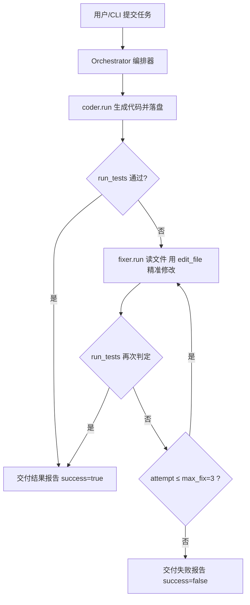

# Design.md · 多 Agent 协作系统（Homework 2）

## 1. 项目目标

在 Homework 1「单 Agent 代码助手」的基础上，扩展为**多 Agent 协作系统**，完成一个
「生成—验证—修复」的自动化编码闭环：

- **编码 Agent（coder）**：根据需求生成代码并落盘；
- **修复 Agent（fixer）**：针对测试失败，对被测文件做最小、精准的修改；
- **编排器（Orchestrator）**：协调二者，统一运行测试并判定通过与否，失败则转交修复，
  反复迭代直到测试通过或达到修复上限。

目标覆盖 Homework 2 要求的多 Agent 设计要素：角色划分、Agent 间协作、统一的任务/状态
编排、可运行可演示。

## 2. 技术选型

| 维度 | 选择 | 理由 |
|------|------|------|
| 语言 | Python 3.9+ | 与 Homework 1 一致，生态成熟 |
| 依赖 | **零第三方依赖**（仅标准库） | 开箱即运行，便于评分演示；测试示例用标准库自写 runner |
| LLM 接入 | 复用 Homework 1 的 `LLMClient` | 一套代码适配 OpenAI / 通义千问 / DeepSeek |
| Agent 范式 | ReAct（推理 + 行动） | 与 Homework 1 一致，多 Agent 各自独立循环 |
| 多 Agent 编排 | Orchestrator 中转消息 | coder/fixer 不直接互调，通过 Orchestrator 解耦 |
| 离线演示 | `ScriptedLLM`（剧本化） | 无需 API Key 即可完整跑通闭环，便于课堂/评分演示 |

> 与 Homework 1 的关系：本系统的 `CodeAgent` / `LLMClient` / `Memory` / 5 个基础工具
> **直接复用** Homework 1；新增的是 `write_file`、`edit_file` 两个写类工具、`Orchestrator`
> 编排层，以及把同一 `CodeAgent` 类实例化为两个角色的能力。

## 3. 系统架构

```
┌──────────────────────────────────────────────────────────────────┐
│                          用户 / CLI (run.py)                       │
└───────────────┬──────────────────────────┬────────────────────────┘
                │ 任务                      │ 结果报告
                ▼                          ▲
        ┌──────────────────────────────────────────┐
        │            Orchestrator (orchestrator.py) │
        │  1. coder.run(task)                       │
        │  2. _run_tests()  → returncode==0 ?       │
        │      是 → 交付                             │
        │      否 → 构造错误上下文 → fixer.run()     │
        │  3. 循环，最多 max_fix=3 次                │
        └───┬───────────────────────┬──────────────┘
            │ 生成代码               │ 修复指令（含失败输出）
            ▼                       ▼
   ┌─────────────────┐      ┌─────────────────┐
   │  编码 Agent      │      │  修复 Agent      │
   │  (coder)        │      │  (fixer)        │
   │  工具: 5 +      │      │  工具: 读/列/运行 │
   │  write_file     │      │  /检索 + edit_file│
   └────────┬────────┘      └────────┬────────┘
            │                        │
            ▼ 共享 workdir（同一批文件） ▼
   ┌──────────────────────────────────────────┐
   │  被测代码 + 测试套件（如 samples/calc.py） │
   └──────────────────────────────────────────┘
```

两个 Agent 是**同一个 `CodeAgent` 类的两个实例**，仅 `tools` 与 `system_prompt` 不同，
共享 `workdir`、各自拥有独立 `Memory`。

### 3.1 流程图（Mermaid）



> 上图即 Homework 2 要求的「基本的流程控制（顺序执行）」+ 循环（重试修复）+ 条件分支
> （测试通过与否）。若 Markdown 渲染器不支持 Mermaid，可看上方 ASCII 架构图。

## 4. 角色与工具差异

| 角色 | 系统提示词职责 | 工具集 | 关键写操作 |
|------|----------------|--------|------------|
| 编码 Agent | 按需求生成可运行代码并落盘 | read_file / list_directory / run_command / search_web / generate_unit_test / **write_file** | `write_file` 创建/覆盖文件 |
| 修复 Agent | 针对测试失败做最小修改 | read_file / list_directory / run_command / search_web / **edit_file** | `edit_file` 精准局部替换 |

新增写类工具的安全约束（统一在 `tools.py` 的 `_safe_join` 中）：
- 只能写/改 `workdir` 之内，越权路径直接拒绝；
- `edit_file` 要求 `old_string` 精确匹配原文件，否则拒绝（避免误改）；
- 命令仍走白名单（`python/pytest/node` 等），禁止任意执行。

## 5. Orchestrator 流程（伪代码）

```text
function run(task):
    report = {task, coder_log, fix_rounds, success:false}

    answer = coder.run(task)                 # 编码 Agent 生成代码
    report.coder_log = coder.steps

    passed, out = run_tests()               # 统一运行测试
    if passed:
        report.success = true; return report

    attempt = 1
    while attempt <= max_fix and not passed:
        prompt = build_fix_prompt(task, attempt, out)   # 错误上下文
        fixer.run(prompt)                     # 修复 Agent 读/改/验
        report.fix_rounds.append(fixer.steps)
        passed, out = run_tests()            # 再次权威判定
        attempt += 1

    report.success = passed
    return report
```

核心设计点：

- **测试权威判定集中在 Orchestrator**：用 `subprocess` 跑 `test_command` 并看 `returncode`，
  避免 Agent「自报通过」带来的不可靠性。
- **最小修改原则**：修复 Agent 用 `edit_file` 替换片段，而非整文件重写，降低引入新 Bug 风险。
- **解耦协作**：coder 与 fixer 互不调用，只通过 Orchestrator 中转的「错误上下文」消息沟通，
  符合多 Agent 系统的关注点分离。

## 6. 对应评审标准

| 评审维度 | 本项目的体现 |
|----------|--------------|
| 多 Agent 角色划分 | coder / fixer 职责清晰，工具集与提示词差异化 |
| Agent 间协作 | Orchestrator 统一调度、消息中转、共享工作区 |
| 架构合理性 | ReAct 循环复用 Homework 1；新增编排层职责单一 |
| 工程完整性 | 工具安全校验、错误重试、可重复演示、设计/运行文档 |
| 可演示性 | 离线脚本化演示（`--demo`）无需 API Key 即可跑通闭环 |

## 6.1 对照 PPT「技术要求」逐条核查

**必须实现（全部满足）**

| 要求 | 本项目体现 |
|------|------------|
| 至少 2 个 Agent 协作完成完整流程 | coder（编码）+ fixer（修复）+ Orchestrator（调度），端到端闭环 |
| Agent 间消息传递或状态共享 | Orchestrator 以 `message{from,to,payload}` 中转错误上下文；coder/fixer 共享同一 `workdir` 文件系统状态 |
| 支持基本流程控制（顺序执行） | coder→测试→fixer→重测，严格顺序编排 |
| MVP 可运行 | `python run.py --demo` 退出码 0，无需任何 API Key |

**推荐实现**

| 要求 | 状态 | 说明 |
|------|------|------|
| 条件分支 / 循环 / 并行 | ✅ 分支+循环 | 测试通过与否=条件分支；`max_fix=3` 重试=循环；并行未做（影响有限） |
| 可视化 Workflow 编排界面 | ⬜ 未做（PPT 标注可选） | 以 `Design.md` 流程图 + 终端日志代替，不扣分 |
| 执行日志与状态追踪 | ✅ | 每轮打印 coder_log / fix_rounds / 测试输出 |
| 错误处理与恢复机制 | ✅ | 工具层 `try/except` 全部兜底；测试失败触发修复重试而非崩溃 |
| 从项目 1 复用 | ✅ | 直接复用 `LLMClient` / `Memory` / `CodeAgent` / 5 个基础工具 |

## 6.2 提交物说明

PPT 第 4 页「提交物」标注为 **（待补充）**——老师尚未给出最终提交清单。
按目前最稳妥的提交形态，本仓库已包含：

- **代码**：`run.py` + `src/`（11 个 `.py`，939 行，零第三方依赖，开箱即跑）
- **架构说明**：本 `Design.md`（目标 / 架构 / 角色 / 流程图 / 评审对应 / 技术要求核查）
- **使用文档**：`README.md`（快速开始 / 角色说明 / 安全约束）
- **可运行示例**：`samples/calc.py`（含 Bug 起点）+ `test_calc.py`（零依赖测试）

> 若老师后续补充提交物（如实验报告 PDF、演示视频、流程图单独文件等），
> 可基于以上材料直接生成，无需改动核心代码。

## 7. 运行与演示

1. **离线演示（推荐，无需 Key）**：
   `python run.py --demo` —— 编码 Agent 写一份含 Bug 的 `calc.py`，
   测试失败后修复 Agent 修正并令测试通过，终端打印结果报告。
2. **真实 LLM 运行**：复制 `.env.example` 为 `.env` 填入 Key，
   `python run.py --task "你的需求" --workdir <目录> --test "python test_x.py"`。
3. **单元级验证**：`python samples/test_calc.py` 可直接观察测试通过/失败。
